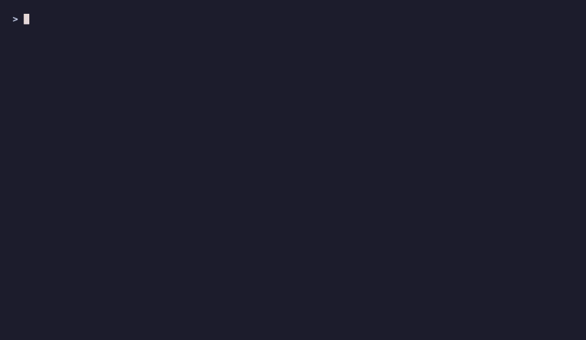
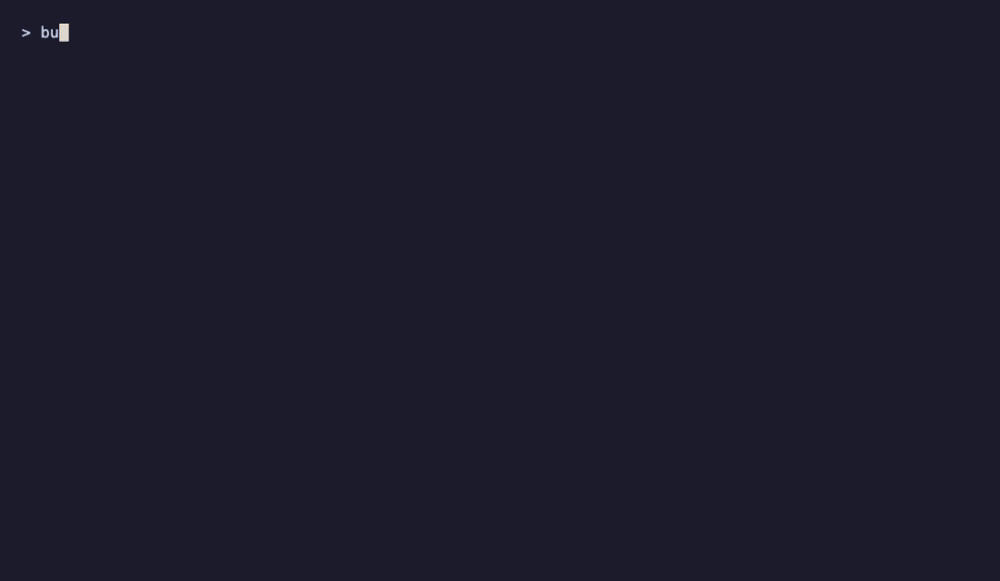
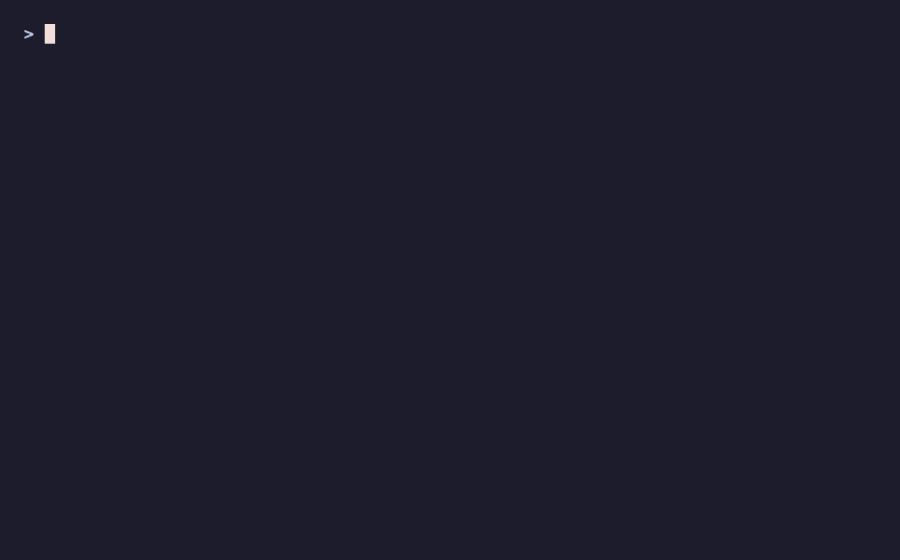
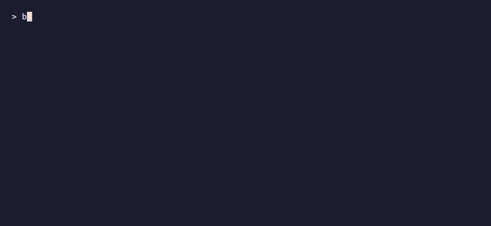

# @oakoliver/bubblezone

Mouse hit-zones for Bubble Tea in TypeScript. Wrap a part of your view in `mark()`, run the finished view through `scan()` once, and ask `get(id).inBounds(msg)` when a mouse event arrives. A TypeScript port of [lrstanley/bubblezone](https://github.com/lrstanley/bubblezone) for [@oakoliver/bubbletea](https://github.com/oakoliver/bubbletea).

**Version 1.0.0** ports upstream at commit [`d3a8f5f`](https://github.com/lrstanley/bubblezone/commit/d3a8f5f72d19043b3fa10006bbdf6d19e29b9cc4) (`master`, eight commits after the `v2.0.0` tag; only CI, docs and lint config changed since the tag), the version built for Bubble Tea v2. It is meant for `@oakoliver/bubbletea` 1.2.x, which has parity with Bubble Tea v2.0.10. See [Parity with upstream](#parity-with-upstream) for what is ported and what differs.


The pointer in this recording is scripted: a terminal recorder cannot click, so the examples have a `--demo` flag that sends real mouse messages to the running program, aimed at zones by ID. See [Recordings](#recordings).

**Read the article:** [Getting Started with Bubblezone in TypeScript](https://engineering.oakoliver.com/articles/getting-started-bubblezone-typescript-clickable-terminal-ui) · [Porting Bubblezone from Go to TypeScript](https://engineering.oakoliver.com/articles/porting-go-bubblezone-to-typescript-mouse-hit-testing-for-bubble-tea)

## Larger Examples

Two full-screen programs in [`examples/`](examples/) use zones for everything you can click, in layouts of bordered panes, wrapped text and dialogs.

### files.ts: a mouse-driven file manager



An invented, in-memory file system (nothing on disk is read or changed). Tabs, toolbar buttons, a clickable path, sidebar places, sortable column headers, list rows, preview buttons, a context menu, dialogs and a scroll bar are all zones. Double-click opens, right-click opens a menu, the wheel scrolls.

### console.ts: a service dashboard



Six service cards with a live sparkline, replica steppers, Restart, Logs and a traffic toggle, a scrolling log with filter chips, and a Deploys table. The buttons sit inside the card zone, so one click lands in several zones at once; the program receives them through `anyInBoundsAndUpdate()` and sorts them out by ID.

### Small examples

| Program | What it shows |
|---|---|
| [`buttons.ts`](examples/buttons.ts) | `mark`, `scan`, `get().inBounds()` and `pos()` in one screen, with hover. |
| [`list.ts`](examples/list.ts) | A Bubbles list whose rows are clickable (port of upstream's `list-default`), and padding a multi-line zone so its box covers the row. |
| [`nested.ts`](examples/nested.ts) | `newPrefix()` for child components and `anyInBoundsAndUpdate()` with `MsgZoneInBounds`. |

 

### Running the examples

The examples import this repository's source. Bubble Tea, Lip Gloss and Bubbles are dev dependencies here:

```bash
git clone https://github.com/oakoliver/bubblezone && cd bubblezone
bun install
bun examples/files.ts            # also: console.ts, buttons.ts, list.ts, nested.ts
bun examples/files.ts --demo     # replay a scripted mouse
```

Keys, flags and details are in [`examples/README.md`](examples/README.md).

## Install

```bash
npm install @oakoliver/bubblezone @oakoliver/bubbletea
```

`@oakoliver/bubbletea` (^1.2.1) is a peer dependency so your program and bubblezone share one copy of Bubble Tea. `@oakoliver/lipgloss` (^1.1.3) is an optional peer dependency: bubblezone does not import it, but zones are only useful with views built the way Lip Gloss builds them.

## Quick Start

```typescript
import {
  type Cmd, type Model, type Msg,
  KeyPressMsg, MouseButton, MouseMode, MouseReleaseMsg, Program, Quit, View,
} from '@oakoliver/bubbletea';
import { joinHorizontal, newStyle, Top } from '@oakoliver/lipgloss';
import * as zone from '@oakoliver/bubblezone';

zone.NewGlobal(); // one app-wide manager; zone.New() makes one you pass around

class App implements Model {
  active = 'none';

  init(): Cmd { return null; }

  update(msg: Msg): [Model, Cmd] {
    if (msg instanceof MouseReleaseMsg && msg.button === MouseButton.Left) {
      if (zone.get('confirm').inBounds(msg)) this.active = 'confirm';
      else if (zone.get('cancel').inBounds(msg)) this.active = 'cancel';
    }
    if (msg instanceof KeyPressMsg && msg.toString() === 'q') return [this, Quit];
    return [this, null];
  }

  view(): View {
    const button = (label: string) => newStyle().padding(0, 3).background('#7D56F4').render(label);
    const buttons = joinHorizontal(Top, zone.mark('confirm', button('OK')), ' ', zone.mark('cancel', button('Cancel')));
    // scan() strips the markers and records where each zone ended up
    const v = new View(zone.scan(newStyle().margin(1, 2).render(buttons + '\n\nlast click: ' + this.active)));
    v.altScreen = true;
    v.mouseMode = MouseMode.CellMotion; // AllMotion if you want hover
    return v;
  }
}

await new Program(new App()).run();
```

- `mark(id, text)` wraps `text` in two invisible markers. They are private ANSI sequences with no width, so Lip Gloss measures, pads, joins and wraps the text as before.
- `scan(view)` goes over the finished view once, removes the markers and stores each zone's box. Call it on the outermost view only.
- `get(id)` returns the zone for `id`. It is never `null`: for an unknown ID you get a zero zone whose `inBounds()` is `false`.
- `zone.inBounds(msg)` is true when the event's cell is inside the zone's box; `zone.pos(msg)` is the cell relative to the zone's top-left, or `[-1, -1]`.

## API

Everything is available as a `Manager` (`zone.New()`) and as functions on the global manager (`zone.NewGlobal()`). The global functions come in two spellings, `Mark` as in Go and `mark`; they are the same functions.

| Upstream (Go) | TypeScript | Notes |
|---|---|---|
| `zone.New() *Manager` | `New(): Manager` | |
| `zone.NewGlobal()`, `zone.DefaultManager` | `NewGlobal()`, `DefaultManager` | `DefaultManager` is `undefined` until `NewGlobal()`; the global functions throw `manager not initialized` before that. |
| `Manager.Mark(id, v)` | `manager.mark(id, v)` / `Mark`, `mark` | Returns `v` unchanged when disabled or when `id` or `v` is empty. |
| `Manager.Scan(v)` | `manager.scan(v)` / `Scan`, `scan` | Zones are stored before it returns. |
| `Manager.Get(id) *ZoneInfo` | `manager.get(id): ZoneInfo` | A zero zone, not `nil`. |
| `Manager.Clear(id)` | `manager.clear(id)` | |
| `Manager.NewPrefix()` | `manager.newPrefix()` | `zone_N__`; the counter is shared by all managers, as upstream. |
| `Manager.SetEnabled(bool)`, `Enabled()` | `setEnabled(bool)`, `enabled()` | |
| `Manager.Close()` | `manager.close()` | Stops storing zones; `scan()` still strips markers. |
| `ZoneInfo.StartX/StartY/EndX/EndY` | `startX/startY/endX/endY` | Zero-based, inclusive. Also `id`, `width`, `height`. |
| `ZoneInfo.IsZero()`, `InBounds(msg)`, `Pos(msg)` | `isZero()`, `inBounds(msg)`, `pos(msg)` | `pos()` returns `[x, y]`. They also accept a plain `{ x, y }`. |
| `MsgZoneInBounds{Zone, Event}` | `MsgZoneInBounds` with `zone`, `event`, `_tag` | |
| `Manager.AnyInBounds(model, msg)` | `manager.anyInBounds(model, msg)` | |
| `Manager.AnyInBoundsAndUpdate(model, msg)` | `manager.anyInBoundsAndUpdate(model, msg): [Model, Cmd]` | Commands are combined with Bubble Tea's `Batch`. |

Also exported: `printableWidth(text)` and `runeWidth(codePoint)`, the width functions the scanner uses.

## Tips

These follow upstream's README, with what was measured against this port.

- **Overlapping IDs.** Use `newPrefix()` in components that can appear more than once and put the prefix in front of their zone IDs. [`nested.ts`](examples/nested.ts) does.
- **Use Lip Gloss's `width()`, not `.length`.** The markers have no width for `width()`/`stringWidth()`. They do count for `.length`.
- **Cutting keeps the zone.** Upstream warns that `MaxWidth()`/`MaxHeight()` hard-trim text and break zones. With Lip Gloss 1.1.3 `maxWidth()`, `truncate()` and `sliceAnsi()` keep the markers where they were, so a zone that is cut shrinks to the part still visible, and a zone cut off entirely becomes empty (its end lies before its start, so nothing is in bounds). Tests cover this; I found no cut that leaves a marker unpaired. Cutting *lines* (a height limit) was not tested.
- **Scan only at the root.** A scan inside a child removes markers the root needs, and each scan forgets zones it did not see.
- **A zone is a box**, from its first cell to its last. A zone that wraps onto a second line ends to the left of where it starts, and `inBounds()` is then `false` everywhere. Keep clickable text to one line, or do your own check.
- **A multi-line zone is only as wide as its last line.** If the lines differ in width, pad them to a common width before `mark()`. [`list.ts`](examples/list.ts) does.
- **Lip Gloss layers and the compositor drop the markers.** `newCompositor(...).render()` removes private escape sequences, so zones marked inside a layer, or in the text under one, are not found (a test shows this, with Lip Gloss 1.1.3). Upstream's README warns about the v2 compositor too. [`examples/_kit.ts`](examples/_kit.ts) has `splice()`, which puts a block over another and keeps the markers; render the page under a dialog without zones so the dialog is the only thing that takes clicks.
- **Alt screen and mouse mode.** Set `view.altScreen = true`, since zones are screen cells; use `MouseMode.CellMotion` for clicks and wheel, `AllMotion` for hover.

## Parity with upstream

Ported from `lrstanley/bubblezone` at `d3a8f5f`:

| Upstream file | Here |
|---|---|
| `manager.go`, `manager_global.go` | `src/manager.ts`, `src/global.ts` |
| `scanner.go` | `src/scanner.ts` (a single pass instead of a state machine), `src/width.ts` |
| `zoneinfo.go` | `src/zoneinfo.ts` |
| `messages.go` | `src/messages.ts`, and `Manager.anyInBounds*` |
| `manager_test.go`, `zoneinfo_test.go`, `messages_test.go` | `tests/manager.test.ts`, `tests/zoneinfo.test.ts`, `tests/messages.test.ts`: every case of the scan table, plus the cases for mark, clear, close, disabled mode, position, bounds, `AnyInBounds` and `AnyInBoundsAndUpdate` |

What is the same: the marker format (`ESC [ <number> z`, numbers from 1001), pairing by marker, positions measured on the cleaned text (width since the last newline, count of newlines), the last zone wins when an ID is marked twice, stale zones dropped on every scan, `MsgZoneInBounds` sent in alphabetical order of ID.

What differs:

1. **`scan()` is synchronous.** Upstream hands zones to a goroutine over a channel, so `Get` right after `Scan` may see old data, and its tests sleep. Here the zones are stored before `scan()` returns, so no test sleeps and `get()` right after `scan()` is correct. `Close()` has no worker to stop; it only turns storing off.
2. **`get()` never returns `nil`.** An unknown ID gives a zero `ZoneInfo`.
3. **Global `SetEnabled(false)` clears the zones**, like the manager's method does. Upstream's global function only flips the flag.
4. **Markers from another manager are stripped and ignored.** Upstream stores them under an empty ID.
5. **Width measurement is self-contained.** Upstream uses `go-runewidth` per code point and ends an escape sequence at the first letter, which also ends a hyperlink (`ESC ] 8 ; ; url BEL`) in the middle of its URL. `printableWidth()` skips OSC, DCS, APC, PM and SOS strings up to BEL or ST. It still counts per code point, as upstream does, so emoji built with a zero-width joiner count each part. It agrees with Lip Gloss's `stringWidth` on every sample in the tests that has no joiner sequences.
6. **`inBounds()` and `pos()` also take a plain `{ x, y }`**, and `ZoneInfo` has `id`, `width` and `height`.
7. **IDs are sorted by UTF-16 code unit**, upstream sorts bytes. The two differ only for IDs that mix characters above U+FFFF with some characters in U+E000–U+FFFF.

Not ported: upstream's Go benchmarks and `FuzzScan` (replaced by `bench/scan.ts` and a seeded random-input test), its `_examples/` programs (replaced by the examples here) and its repository tooling.

New tests that upstream does not have: measuring (wide characters, combining marks, hyperlinks), Lip Gloss layout (`joinHorizontal`, borders, padding, `place`, wrapping, `maxWidth`, compositor), two managers side by side, and the Quick Start above.

## Development

```bash
bun install
bun test              # 122 tests
bun run typecheck     # the library
bun run typecheck:examples
bun bench/scan.ts     # timings
npm run build         # dist/index.js, dist/index.cjs, dist/*.d.ts
```

## Recordings

The GIFs were recorded with [VHS](https://github.com/charmbracelet/vhs) from the tapes in `assets/tapes/`, run from the repository root: `vhs assets/tapes/files.tape`. VHS has no mouse commands (and its scroll commands do not arrive as wheel events), so each example takes `--demo`: a script in the example sends real `MouseMotionMsg`, `MouseClickMsg`, `MouseReleaseMsg` and `MouseWheelMsg` values to the running program with `program.send()`. The targets are zone IDs; for each step the script asks the zone manager where the zone is and aims at its middle, so a scripted click goes through the same `inBounds()` checks as a real one. A yellow cell shows the scripted pointer and a badge in the last row says `demo: scripted mouse`. What this does not test is the terminal's own mouse reporting; the Quick Start and the guide's programs were also run with real SGR mouse sequences written to a pseudo-terminal.

## License

MIT. Copyright (c) 2025 Antonio Oliveira and (c) 2022 Liam Stanley, who wrote the original bubblezone. See [LICENSE](LICENSE).
